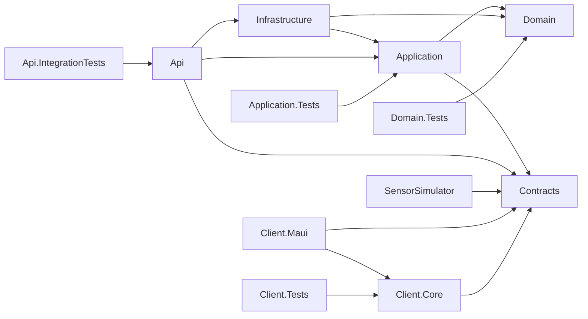

# Microclimate — моніторинг мікроклімату приміщень


Кросплатформна .NET-система для моніторингу температури, вологості, CO₂, PM2.5, шуму й освітленості. Плануються історія вимірювань, аналітика комфорту, налаштування порогів та сповіщення. Domain уже містить кімнати, датчики, виміри, пороги, сповіщення й користувачів; будівлі до моделі не входять. Клієнт має HTTP-сценарії входу, кімнат, аналітики й сповіщень за Contracts. Реальні предметні endpoints backend ще не реалізовані; статус клієнта й перевірок — у docs/client-progress.md.

## Команда

| Учасник | Відповідальність |
|---|---|
| 1 | Domain, Application, Infrastructure, SensorSimulator: дані, EF Core, аналітика |
| 2 | Api, Contracts: REST API, JWT, SignalR, OpenTelemetry |
| 3 | Client.Maui, Client.Core, deploy/, .github/, solution, CI, README |

Деталі: [зони відповідальності](docs/responsibility-zones.md). Імена учасників додає команда.

## Архітектура

```text
src/
  Microclimate.Domain/            Кімнати, датчики, виміри, пороги, сповіщення, користувачі
  Microclimate.Contracts/         Спільні DTO; частина старих контрактів ще потребує узгодження
  Microclimate.Application/       Порти сховища, прийому вимірів та аналітики
  Microclimate.Infrastructure/    Реалізації доступу до даних; порожня бібліотека
  Microclimate.Api/               Службові endpoints /health і /api/v1/ping
  Microclimate.SensorSimulator/   Стандартний Worker шаблон, без симуляції датчиків
  Microclimate.Client.Core/       ViewModels, HTTP, сесія та проєкції без MAUI
  Microclimate.Client.Maui/       Кросплатформний UI, MVVM, навігація та графік із прогалинами
tests/
  Microclimate.Domain.Tests/          Тести предметної моделі
  Microclimate.Application.Tests/     Тести прикладних типів
  Microclimate.Api.IntegrationTests/  Тести службових API endpoints
  Microclimate.Client.Tests/          Тести HTTP, сесій, ViewModels та проєкцій
```

Стрілки позначають **посилання на проєкти**, а не мережеві виклики:



Domain і Contracts не посилаються на інші проєкти. Client.Core містить ViewModels, HTTP, сесію та логіку відображення і тестується на Linux; нативні екрани, сховище та малювання — у MAUI.

## Вимоги

- .NET SDK **10.0.300**, зафіксований у `global.json`; `latestFeature` дозволяє сумісну новішу feature-band .NET 10.
- Для сервера й тестів MAUI workload не потрібний.
- Для MAUI: `dotnet workload install maui` та SDK потрібної платформи. Android потребує JDK та Android SDK; MacCatalyst/iOS — сумісного Xcode; Windows — Windows SDK.
- JetBrains Rider з підтримкою .NET 10, Visual Studio 2026 або VS Code + C# Dev Kit; для MAUI у VS Code також .NET MAUI extension.
- Docker Desktop потрібний для локального PostgreSQL і контейнерного запуску; див. deploy/README.md.
- Git; GitHub CLI для issues, PR та перевірки CI.

## Швидкий старт: сервер і тести (будь-яка ОС)

```bash
git clone https://github.com/katyadn/mppSTEM.git
cd mppSTEM
dotnet restore Microclimate.Ci.slnf
dotnet build Microclimate.Ci.slnf -c Release --no-restore
dotnet test Microclimate.Ci.slnf -c Release --no-build
```

У Rider відкрийте `Microclimate.slnx`. Для перевірки серверної частини з термінала використовуйте `Microclimate.Ci.slnf`; відкриття повного solution може вимагати локальних платформних SDK MAUI.

Локальний API:

```bash
dotnet run --project src/Microclimate.Api --launch-profile http
```

Порт задається в `src/Microclimate.Api/Properties/launchSettings.json`; Службові endpoints: `/health` і `/api/v1/ping`; WeatherForecast видалено Учасником 2.

## MAUI: Windows

У терміналі на **Windows**:

```powershell
dotnet workload install maui-windows
dotnet build src/Microclimate.Client.Maui -c Release -f net10.0-windows10.0.19041.0 -p:MauiTargetFramework=net10.0-windows10.0.19041.0
dotnet build src/Microclimate.Client.Maui -t:Run -f net10.0-windows10.0.19041.0 -p:MauiTargetFramework=net10.0-windows10.0.19041.0
```

Явне `MauiTargetFramework` обмежує restore платформою Windows, тому команда не потребує Android SDK. Перевірте Login → Dashboard, деталі кімнати, вкладки Alerts/Settings і вихід; додайте реальні скриншоти у `docs/ui/screenshots/stage-0/`.

Поточна локальна перешкода (2026-10-18): після оновлення Xcode до 27.1 повний Mac build з workload 27.0.10722 зупиняється на перевірці сумісності; наведені нижче команди потребують саме сумісного Xcode 27.0. Новий UI-run наразі не підтверджений.

## MAUI: macOS / Android

На Mac із **Xcode 27.0** використовуйте .NET SDK **10.0.401** і workload set **10.0.401.1** ([офіційний реліз](https://github.com/dotnet/macios/releases/tag/dotnet-10.0.1xx-xcode27.0-10722)). Мінімальна версія MacCatalyst — 17.0; scene lifecycle налаштований у `Platforms/MacCatalyst/`.

```bash
export PATH="$HOME/.dotnet:$PATH"
dotnet workload install maui-maccatalyst --version 10.0.401.1
dotnet build src/Microclimate.Client.Maui -t:Rebuild -f net10.0-maccatalyst -p:MauiTargetFramework=net10.0-maccatalyst -p:RuntimeIdentifier=maccatalyst-arm64 -p:EnableCodeSigning=true -p:CodesignKey=-
open src/Microclimate.Client.Maui/bin/Debug/net10.0-maccatalyst/maccatalyst-arm64/Мікроклімат.app
```

`CodesignKey=-` створює локальний ad-hoc підпис для Debug-запуску. Для розповсюдження потрібний підпис розробника. Перебудова оновлює manifest після зміни SDK та конфігурації вікна. 2026-10-13 на macOS 27 перевірено вхід → огляд → деталі → назад, вкладки сповіщень/налаштувань і вихід. Екрани залишаються каркасом без серверної інтеграції.

На Intel Mac замініть runtime на `maccatalyst-x64`. Для Android після встановлення JDK та Android SDK:

```bash
dotnet build src/Microclimate.Client.Maui -f net10.0-android -p:MauiTargetFramework=net10.0-android
```

## CI та межі Етапу 0

CI має два jobs: Linux `build-test` (restore, строгий Release build, тести, coverage artifact/summary) і Windows `maui-build`. Перевіряються Domain, Application, API та Client.Core. Клієнтські тести покривають HTTP, сесію, ViewModels, NoData та розриви часового ряду; Windows job перевіряє нативну збірку.

Клієнтський вхід тепер викликає API та зберігає access-сесію в системному захищеному сховищі (або лише в пам’яті, якщо сховище недоступне). Кімнати, деталі та сповіщення завантажуються HTTP-запитами; є пагінація, фільтри й повідомлення про помилки. Повний потік поки перевірено на тестовому HTTP-сервері: предметний backend очікує реалізації Учасниками 1 і 2. [Статус клієнта — орієнтир 50%](docs/client-progress.md).

## Запуск через Docker

[Інструкція Docker Compose](deploy/README.md): PostgreSQL запускається окремо; профіль app збирає API й simulator та передає конфігурацію Database. Сховище EF Core й реальна симуляція ще не реалізовані.

## Документація

- [Правила внеску](CONTRIBUTING.md)
- [Архітектурні рішення](DECISIONS.md)
- [Журнал генерації та ШІ](META-USAGE.md)
- [Документація](docs/)
- [Підсумковий чекліст](docs/stage-0-checklist.md)
