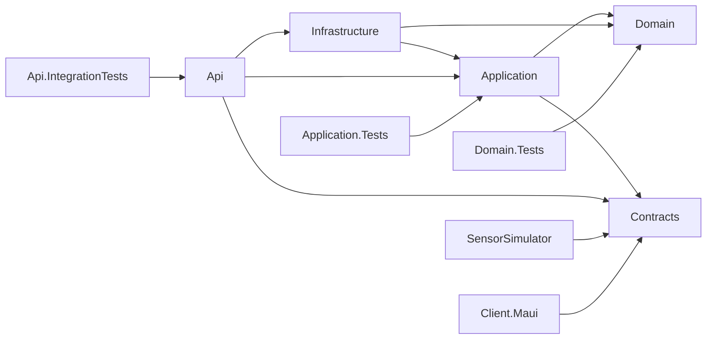

# Microclimate — моніторинг мікроклімату приміщень


Кросплатформна .NET-система для моніторингу температури, вологості, CO₂, PM2.5, шуму й освітленості. Плануються історія вимірювань, аналітика комфорту, налаштування порогів та сповіщення. Етап 0 містить каркас проєктів і клієнта; реальних вимірювань та автентифікації ще немає.

## Команда

| Учасник | Відповідальність |
|---|---|
| 1 | Domain, Application, Infrastructure, SensorSimulator: дані, EF Core, аналітика |
| 2 | Api, Contracts: REST API, JWT, SignalR, OpenTelemetry |
| 3 | Client.Maui, deploy/, .github/, solution, CI, README |

Деталі: [зони відповідальності](docs/responsibility-zones.md). Імена учасників додає команда.

## Архітектура

```text
src/
  Microclimate.Domain/            Предметна модель; порожня бібліотека
  Microclimate.Contracts/         Спільні контракти; порожня бібліотека
  Microclimate.Application/       Прикладні сценарії; порожня бібліотека
  Microclimate.Infrastructure/    Реалізації доступу до даних; порожня бібліотека
  Microclimate.Api/               Стандартний Web API шаблон з WeatherForecast
  Microclimate.SensorSimulator/   Стандартний Worker шаблон, без симуляції датчиків
  Microclimate.Client.Maui/       Кросплатформний UI, каркас MVVM і навігації
tests/
  Microclimate.Domain.Tests/          Заглушка майбутніх предметних тестів
  Microclimate.Application.Tests/     Заглушка майбутніх прикладних тестів
  Microclimate.Api.IntegrationTests/  Заглушка майбутніх інтеграційних тестів
  Microclimate.Client.Tests/          Заглушка без залежності від MAUI
```

Стрілки позначають **посилання на проєкти**, а не мережеві виклики:



Domain і Contracts не посилаються на інші проєкти. ViewModels надалі буде винесено в окрему бібліотеку для тестування на Linux.

## Вимоги

- .NET SDK **10.0.300**, зафіксований у `global.json`; `latestFeature` дозволяє сумісну новішу feature-band .NET 10.
- Для сервера й тестів MAUI workload не потрібний.
- Для MAUI: `dotnet workload install maui` та SDK потрібної платформи. Android потребує JDK та Android SDK; MacCatalyst/iOS — сумісного Xcode; Windows — Windows SDK.
- JetBrains Rider з підтримкою .NET 10, Visual Studio 2026 або VS Code + C# Dev Kit; для MAUI у VS Code також .NET MAUI extension.
- Docker Desktop знадобиться на Етапі 2. На Етапі 0 контейнери не запускаються.
- Git; GitHub CLI для issues, PR та перевірки CI.

## Швидкий старт: сервер і тести (будь-яка ОС)

```bash
git clone https://github.com/katyadn/mppSTEM.git
cd mppSTEM
dotnet restore Microclimate.Ci.slnf
dotnet build Microclimate.Ci.slnf -c Release --no-restore
dotnet test Microclimate.Ci.slnf -c Release --no-build
```

Поки PR Етапу 0 не злиті, після clone виконайте `git switch feature/7-stage0-docs`, щоб отримати повний каркас. Після merge цей крок більше не потрібний.

У Rider відкрийте `Microclimate.slnx`. Для перевірки серверної частини з термінала використовуйте `Microclimate.Ci.slnf`; відкриття повного solution може вимагати локальних платформних SDK MAUI.

API на Етапі 0 запускається як демонстраційний шаблон:

```bash
dotnet run --project src/Microclimate.Api --launch-profile http
```

Порт задається в `src/Microclimate.Api/Properties/launchSettings.json`; `/WeatherForecast` є шаблонним endpoint і не є API системи мікроклімату.

## MAUI: Windows

У терміналі на **Windows**:

```powershell
dotnet workload install maui-windows
dotnet build src/Microclimate.Client.Maui -c Release -f net10.0-windows10.0.19041.0 -p:MauiTargetFramework=net10.0-windows10.0.19041.0
dotnet build src/Microclimate.Client.Maui -t:Run -f net10.0-windows10.0.19041.0 -p:MauiTargetFramework=net10.0-windows10.0.19041.0
```

Явне `MauiTargetFramework` обмежує restore платформою Windows, тому команда не потребує Android SDK. Перевірте Login → Dashboard, деталі кімнати, вкладки Alerts/Settings і вихід; додайте реальні скриншоти у `docs/ui/screenshots/stage-0/`.

## MAUI: macOS / Android

На Mac із **Xcode 26.6**, сумісним зі встановленим стабільним MacCatalyst SDK 26.5:

```bash
dotnet build src/Microclimate.Client.Maui -f net10.0-maccatalyst -p:MauiTargetFramework=net10.0-maccatalyst -p:RuntimeIdentifier=maccatalyst-arm64 -p:EnableCodeSigning=false
dotnet build src/Microclimate.Client.Maui -t:Run -f net10.0-maccatalyst -p:MauiTargetFramework=net10.0-maccatalyst -p:RuntimeIdentifier=maccatalyst-arm64 -p:EnableCodeSigning=false
```

Локально Xcode 27 наразі несумісний: стабільний SDK вимагає 26.6, а preview SDK завершився помилкою native linker `EnhancedLinkSecurity`. Повний Mac-запуск не підтверджено; Xcode для інших проєктів не змінювався.

`EnableCodeSigning=false` використовується лише для локальної незапакованої Debug-перевірки, не для розповсюдження. На Intel Mac замініть runtime на `maccatalyst-x64`. Для Android після встановлення JDK та Android SDK:

```bash
dotnet build src/Microclimate.Client.Maui -f net10.0-android -p:MauiTargetFramework=net10.0-android
```

## CI та межі Етапу 0

CI має два jobs: Linux `build-test` (restore, строгий Release build, чотири заглушки, coverage artifact/summary) і Windows `maui-build`. Заглушки перевіряють запуск xUnit, а не предметну логіку; нульове покриття бізнес-коду на цьому етапі очікуване.

Кнопка входу — навігаційна заглушка; ролі, пароль, HTTP, DTO, історія, графіки та реальні сповіщення реалізуються на наступних етапах. [Вайрфрейми](docs/ui/wireframes.md) — чернетка для погодження командою.

## Запуск через Docker

З’явиться на **Етапі 2**. У `deploy/` зараз тільки пояснення меж етапу, Dockerfile та compose ще не створено.

## Документація

- [Правила внеску](CONTRIBUTING.md)
- [Архітектурні рішення](DECISIONS.md)
- [Журнал генерації та ШІ](META-USAGE.md)
- [Документація](docs/)
- [Підсумковий чекліст](docs/stage-0-checklist.md)
