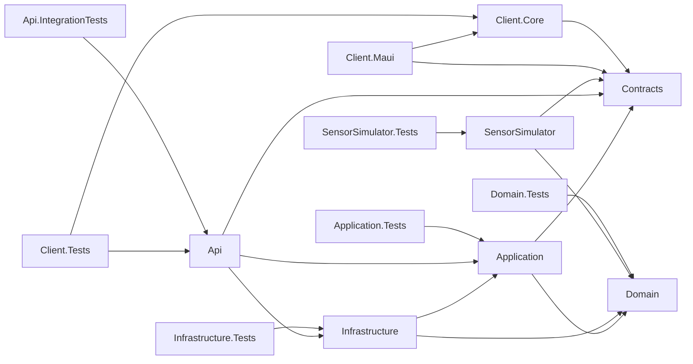

# Microclimate — моніторинг мікроклімату приміщень


Кросплатформна .NET-система для моніторингу температури, вологості, CO₂, PM2.5, шуму й освітленості. Реалізовано історію вимірювань, аналітику комфорту, клієнтське редагування порогів та живі сповіщення. Domain уже містить кімнати, датчики, виміри, пороги, сповіщення й користувачів; будівлі до моделі не входять. Клієнт має HTTP-сценарії входу, кімнат, аналітики й сповіщень за Contracts. API вже містить JWT, кімнати, датчики, виміри, аналітику, сповіщення та користувачів; Infrastructure — EF Core для SQLite/PostgreSQL. Клієнт узгоджено з поточними відповідями сервера; статус перевірок — у docs/client-progress.md.

## Команда

| Учасник | Відповідальність |
|---|---|
| 1 | Domain, Application, Infrastructure, SensorSimulator: дані, EF Core, аналітика |
| 2 | Api, Contracts: REST API, JWT, SignalR, OpenTelemetry |
| 3 | Client.Maui, Client.Core, deploy/, .github/, solution, CI, README |

Деталі: [зони відповідальності](docs/responsibility-zones.md). Імена учасників додає команда.

## Архітектура

```text
src/
  Microclimate.Domain/            Кімнати, датчики, виміри, пороги, сповіщення, користувачі
  Microclimate.Contracts/         Спільні DTO; частина старих контрактів ще потребує узгодження
  Microclimate.Application/       Порти сховища, прийому вимірів та аналітики
  Microclimate.Infrastructure/    EF Core, SQLite/PostgreSQL, міграції та репозиторії
  Microclimate.Api/               REST API, JWT, прийом вимірів, аналітика й SignalR
  Microclimate.SensorSimulator/   Симулятор датчиків: добові коливання, сценарій перегріву, відправлення в API
  Microclimate.Client.Core/       ViewModels, HTTP, сесія та проєкції без MAUI
  Microclimate.Client.Maui/       Кросплатформний UI, MVVM, навігація та графік із прогалинами
tests/
  Microclimate.Domain.Tests/          Тести предметної моделі
  Microclimate.Application.Tests/     Тести прикладних типів
  Microclimate.Api.IntegrationTests/  Тести службових API endpoints
  Microclimate.Client.Tests/          HTTP, сесії, ViewModels, проєкції та інтеграція з API/SQLite
  Microclimate.Infrastructure.Tests/  Репозиторії та аналітика з БД
  Microclimate.SensorSimulator.Tests/ Генерація значень, сценарії та відправлення вимірів
```

Стрілки позначають **посилання на проєкти**, а не мережеві виклики:



Domain і Contracts не посилаються на інші проєкти. Client.Core містить ViewModels, HTTP, сесію та логіку відображення і тестується на Linux; нативні екрани, сховище та малювання — у MAUI.

## Вимоги

- .NET SDK **10.0.300**, зафіксований у `global.json`; `latestFeature` дозволяє сумісну новішу feature-band .NET 10.
- Для сервера й тестів MAUI workload не потрібний.
- Для MAUI: `dotnet workload install maui` та SDK потрібної платформи. Android потребує JDK та Android SDK; MacCatalyst/iOS — сумісного Xcode; Windows — Windows SDK.
- JetBrains Rider з підтримкою .NET 10, Visual Studio 2026 або VS Code + C# Dev Kit; для MAUI у VS Code також .NET MAUI extension.
- Docker Desktop потрібний для локального PostgreSQL і контейнерного запуску; див. deploy/README.md.
- Git; GitHub CLI для issues, PR та перевірки CI.

## Швидкий старт: сервер і тести (будь-яка ОС)

```bash
git clone https://github.com/katyadn/mppSTEM.git
cd mppSTEM
dotnet restore Microclimate.Ci.slnf
dotnet build Microclimate.Ci.slnf -c Release --no-restore
dotnet test Microclimate.Ci.slnf -c Release --no-build
```

У Rider відкрийте `Microclimate.slnx`. Для перевірки серверної частини з термінала використовуйте `Microclimate.Ci.slnf`; відкриття повного solution може вимагати локальних платформних SDK MAUI.

Локальний API:

```bash
dotnet run --project src/Microclimate.Api --launch-profile http
```

Порт задається в `src/Microclimate.Api/Properties/launchSettings.json`. Профіль `http` використовує SQLite, застосовує міграції й додає демо-дані до порожньої БД у Development. Перевірка готовності: `http://localhost:5195/health`, Swagger UI: `http://localhost:5195/swagger`.

Для входу в клієнт на цьому ж комп'ютері відкрийте «Адреса API та налаштування», задайте `http://localhost:5195/` і збережіть. Демо-вхід: `operator@microclimate.local` / `OperatorPassword123!`; адміністратор: `admin@microclimate.local` / `AdminPassword123!`. Ці публічні тестові значення походять із Development seed і не є обліковими даними для публічного сервера. Для Android Emulator адреса API — `http://10.0.2.2:5195/`; для iOS Simulator — `http://localhost:5195/`.

У новій БД вимірів ще немає: це очікуваний стан «Немає даних». Для демонстрації в окремій Development-БД можна виконати `python3 deploy/smoke.py http://localhost:5195`: скрипт додає синтетичні показники й змінює тестові пороги. Подробиці змін — у [deploy/README.md](deploy/README.md).

Симулятор датчиків (у другому терміналі, поки працює API). Id датчика видно в Swagger: `GET /api/v1/rooms/{roomId}/sensors`; ключ демо-датчика з Development seed — `test-device-key-12345`. У Swagger спочатку виконайте `POST /api/v1/auth/login` і передайте отриманий access token через Authorize.

```bash
dotnet user-secrets set "Simulator:Sensors:0:SensorId" "<id датчика>" --project src/Microclimate.SensorSimulator
dotnet user-secrets set "Simulator:Sensors:0:DeviceKey" "<ключ датчика>" --project src/Microclimate.SensorSimulator
dotnet run --project src/Microclimate.SensorSimulator
```

Сценарій перегріву: `Simulator:Sensors:0:Scenario` = `Overheat`. Налаштування й формули — [docs/simulator.md](docs/simulator.md).

## MAUI: Windows

У терміналі на **Windows**:

```powershell
dotnet workload install maui-windows
dotnet build src/Microclimate.Client.Maui -c Release -f net10.0-windows10.0.19041.0 -p:MauiTargetFramework=net10.0-windows10.0.19041.0
dotnet build src/Microclimate.Client.Maui -t:Run -f net10.0-windows10.0.19041.0 -p:MauiTargetFramework=net10.0-windows10.0.19041.0
```

Явне `MauiTargetFramework` обмежує restore платформою Windows, тому команда не потребує Android SDK. Перевірте Login → Dashboard, деталі кімнати, вкладки Alerts/Settings і вихід; додайте реальні скриншоти у `docs/ui/screenshots/stage-0/`.

## MAUI: macOS / Android

Перевірена поточна комбінація для Mac: **Xcode 27.2**, **.NET SDK/workload set 10.0.404**, MAUI **10.0.110**. Встановіть SDK 10.0.404 і перевірте `dotnet --version` перед командами нижче. Сумісність Apple SDK — в [офіційному релізі](https://github.com/dotnet/macios/releases/tag/dotnet-10.0.1xx-xcode27.2.10000). Мінімальна версія MacCatalyst — 17.0.

```bash
dotnet workload install maui-maccatalyst --version 10.0.404
dotnet build src/Microclimate.Client.Maui -c Debug -f net10.0-maccatalyst -p:MauiTargetFramework=net10.0-maccatalyst -p:RuntimeIdentifier=maccatalyst-arm64 -p:EnableCodeSigning=true -p:CodesignKey=-
open src/Microclimate.Client.Maui/bin/Debug/net10.0-maccatalyst/maccatalyst-arm64/Мікроклімат.app
```

`CodesignKey=-` — локальний ad-hoc підпис Debug-запуску. Якщо SecureStorage недоступне, застосунок показує «Сесія діє до закриття застосунку»; постійне сховище потребує належного підпису. API запускається в іншому терміналі за інструкцією вище. [Нативний прогін 15.11](docs/ui/mac-smoke-2026-11-15.md) містить фактичні сценарії й скриншоти. Для старого Xcode 27.1 історична комбінація SDK 10.0.402 / workload 10.0.402.1 описана у [прогоні 24.10](docs/ui/mac-smoke-2026-10-24.md).

На Intel Mac замініть runtime на `maccatalyst-x64`. Для Android встановіть .NET SDK 10.0.404, JDK 21 та Android SDK. Потім:

```bash
dotnet workload install maui-android --version 10.0.404
dotnet build src/Microclimate.Client.Maui -c Release -f net10.0-android -p:MauiTargetFramework=net10.0-android
```

## CI та перевірки клієнта

CI має чотири jobs: Linux `build-test` (restore, строгий Release build, тести, coverage artifact/summary), Windows `maui-build`, Android `android-build` і `postgres-smoke` з API та PostgreSQL у Compose. Клієнтські тести покривають HTTP, сесію, ViewModels, NoData, розриви часового ряду, пороги та SignalR; платформні jobs перевіряють збірку. Artifact `static-analysis` містить SARIF кожного .NET-проєкту та журнал збірки; `coverage-report` — справжній звіт покриття, `test-results` — TRX.

Клієнтський вхід викликає API та зберігає access-сесію в системному захищеному сховищі (або лише в пам’яті, якщо сховище недоступне). Кімнати, деталі та сповіщення завантажуються HTTP-запитами; є пагінація, фільтри й повідомлення про помилки. Потік вхід → кімнати → аналітика → підтвердження сповіщення → вихід перевірено із чинними контролерами API та SQLite через ASP.NET Core TestServer, а окремий нативний MacCatalyst прогін описано у [UI-звіті](docs/ui/mac-smoke-2026-11-15.md). [Стан клієнта та межі перевірок](docs/client-progress.md).

## Запуск через Docker

[Інструкція Docker Compose](deploy/README.md): PostgreSQL запускається окремо; профіль app збирає API й simulator та передає конфігурацію Database. API застосовує міграції PostgreSQL під час старту; симулятор надсилає виміри від датчика, заданого в deploy/.env.

## Документація

- [Правила внеску](CONTRIBUTING.md)
- [Архітектурні рішення](DECISIONS.md)
- [Журнал генерації та ШІ](META-USAGE.md)
- [Документація](docs/)
- [Підсумковий чекліст](docs/stage-0-checklist.md)

## Завершення клієнтських сценаріїв (Учасник 3)

Клієнт підтримує пороги Admin/Operator, останні виміри в огляді, SignalR із reconnect і fallback, деталі точок графіка та локальну тему. Опис і фактичні перевірки: [стан клієнта](docs/client-progress.md), [звіт для захисту](docs/participant-3-report.md). Для Xcode 27.2 використовуйте .NET SDK/workload set 10.0.404; сумісність зафіксована в D-3-023.

CI містить `build-test`, `maui-build` (Windows), `android-build` та `postgres-smoke`. Останній запускає PostgreSQL і API та перевіряє HTTP-сценарій, а не лише синтаксис Compose. Збірки Windows/Android не замінюють ручного тестування UI.
