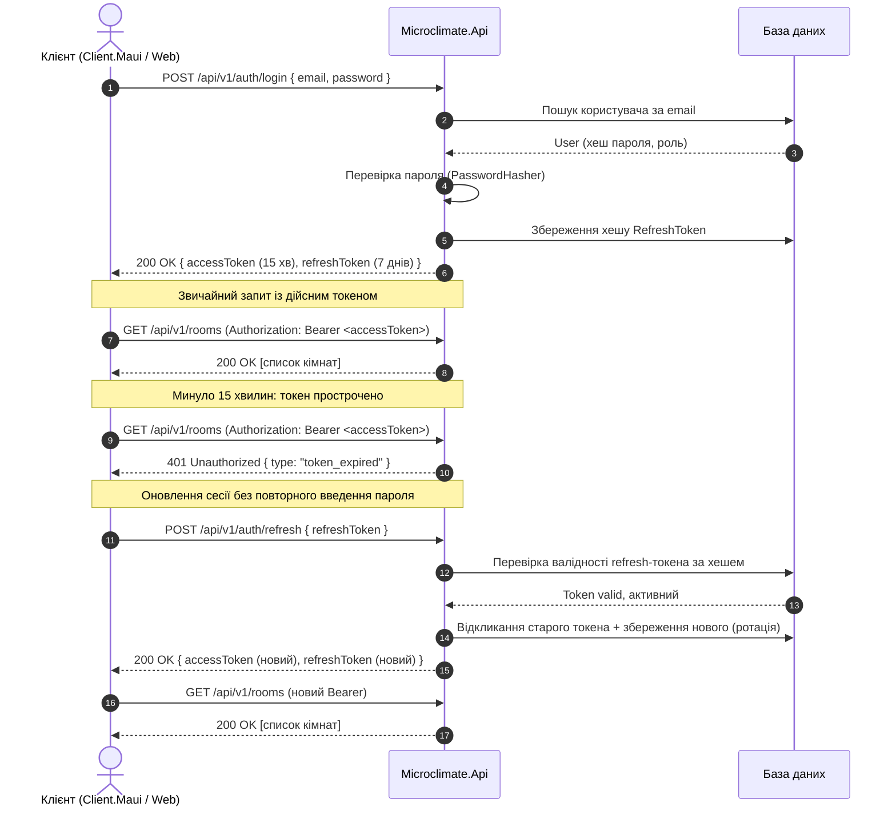
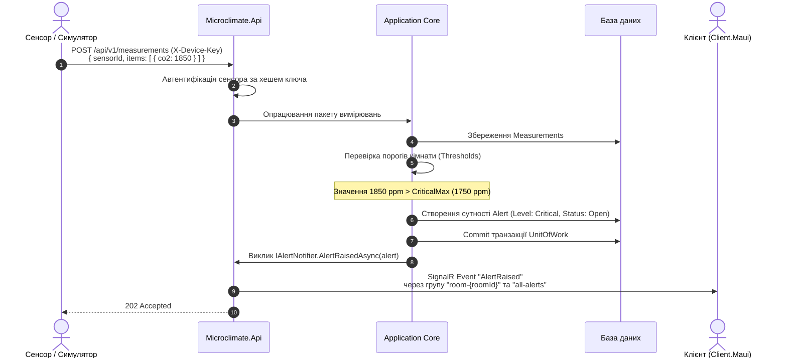

# Специфікація REST API Microclimate (v1)

Цей документ визначає публічний контракт REST API для системи моніторингу мікроклімату приміщень. Контракт є спільним для всіх учасників:
- **Учасник 1** реалізує бізнес-логіку, сервіси Application та збереження даних в Infrastructure.
- **Учасник 2** реалізує хост API, контролери, авторизацію, валідацію, обробку помилок та інтеграційні тести.
- **Учасник 3** споживає цей API у клієнтському додатку `Client.Maui`.

---

## 1. Загальні конвенції

- **Базовий шлях:** `/api/v{version}/...`, поточна підтримувана версія — `v1`. Версія обов'язково задається першим сегментом URL шляху.
  - Службові ендпоінти перевірки стану (наприклад, `/health`) розташовуються поза префіксом `/api` і не версіонуються.
- **Формат передачі даних:** `application/json` у кодуванні UTF-8.
- **Іменування JSON-полів:** `camelCase` для всіх властивостей.
- **Серіалізація переліків (enum):** рядкові значення (`string`), а не числові індекси (наприклад, `"temperature"`, `"warning"`, `"admin"`).
- **Формат дати та часу:** `DateTimeOffset` у форматі UTC відповідно до стандарту ISO 8601 (`YYYY-MM-DDTHH:mm:ssZ`, наприклад `2026-10-12T14:30:00Z`).
- **Ідентифікатори сутностей:** UUID / `Guid` у форматі 36 символів через дефіс (`00000000-0000-0000-0000-000000000000`).
- **Пагінація:**
  - Query-параметри: `page` (ціле число, нумерація з `1`) та `pageSize` (за замовчуванням `20`, мінімум `1`, максимум `100`).
  - Формат уніфікованої відповіді:
    ```json
    {
      "items": [ ... ],
      "page": 1,
      "pageSize": 20,
      "totalCount": 42
    }
    ```
- **Фільтрація за часовим періодом:**
  - Параметри `from` та `to` передаються у форматі ISO 8601 UTC.
  - Інтервал `to - from` не повинен перевищувати 90 календарних днів (для погодинних агрегацій `interval=hour` — не більше 31 дня). Якщо інтервал більший або `from > to`, API повертає `400 Bad Request`.
- **Одиниці вимірювання та фізичні межі сенсорів:**

| MetricType | Одиниця | Фізично допустимий діапазон датчика | Опис |
|---|---|---|---|
| `temperature` | °C | −40.0 … 85.0 | Температура повітря |
| `humidity` | % | 0.0 … 100.0 | Відносна вологість |
| `co2` | ppm | 0.0 … 10000.0 | Концентрація діоксиду вуглецю |
| `pm25` | µg/m³ | 0.0 … 1000.0 | Дрібнодисперсний пил PM2.5 |
| `noise` | dB | 0.0 … 140.0 | Рівень акустичного шуму |
| `light` | lux | 0.0 … 100000.0 | Рівень освітленості |

*Примітка:* Значення поза цими межами відхиляються API на рівні валідації запиту (код `400 Bad Request`). Оптимальні та критичні пороги якості середовища для кожної кімнати визначаються в `docs/analytics.md` і контролюються через сутність `Threshold`.

- **Автентифікація запитів:**
  - Для користувачів (людей): заголовок `Authorization: Bearer <accessToken>`.
  - Для апаратних датчиків / симулятора: заголовок `X-Device-Key: <secret-raw-key>`.
  - Деталі описано в [docs/security.md](security.md).

---

## 2. Специфікація ендпоінтів v1

### 2.1. Автентифікація (`/api/v1/auth`)

| Метод | Маршрут | Ролі | Тіло запиту | Query-параметри | Успішна відповідь | Можливі помилки |
|---|---|---|---|---|---|---|
| `POST` | `/auth/login` | Anonymous | `LoginRequest` | — | `200 OK` → `TokenResponse` | `400`, `401` |
| `POST` | `/auth/refresh` | Anonymous | `RefreshTokenRequest` | — | `200 OK` → `TokenResponse` | `400`, `401` |
| `POST` | `/auth/logout` | Authenticated | — | — | `204 No Content` | `401` |
| `GET` | `/auth/me` | Authenticated | — | — | `200 OK` → `UserResponse` | `401` |

### 2.2. Користувачі (`/api/v1/users`)

| Метод | Маршрут | Ролі | Тіло запиту | Query-параметри | Успішна відповідь | Можливі помилки |
|---|---|---|---|---|---|---|
| `GET` | `/users` | `Admin` | — | `page`, `pageSize` | `200 OK` → `PagedResponse<UserResponse>` | `401`, `403` |
| `POST` | `/users` | `Admin` | `CreateUserRequest` | — | `201 Created` → `UserResponse` | `400`, `401`, `403`, `409` |
| `PUT` | `/users/{id}/role` | `Admin` | `ChangeRoleRequest` | — | `200 OK` → `UserResponse` | `400`, `401`, `403`, `404` |
| `DELETE` | `/users/{id}` | `Admin` | — | — | `204 No Content` | `401`, `403`, `404`, `409` |

### 2.3. Будівлі (`/api/v1/buildings`)

| Метод | Маршрут | Ролі | Тіло запиту | Query-параметри | Успішна відповідь | Можливі помилки |
|---|---|---|---|---|---|---|
| `GET` | `/buildings` | `Admin`, `Operator`, `Viewer` | — | — | `200 OK` → `IReadOnlyList<BuildingResponse>` | `401` |
| `GET` | `/buildings/{id}` | `Admin`, `Operator`, `Viewer` | — | — | `200 OK` → `BuildingResponse` | `401`, `404` |
| `POST` | `/buildings` | `Admin` | `CreateBuildingRequest` | — | `201 Created` → `BuildingResponse` | `400`, `401`, `403`, `409` |
| `PUT` | `/buildings/{id}` | `Admin` | `UpdateBuildingRequest` | — | `200 OK` → `BuildingResponse` | `400`, `401`, `403`, `404`, `409` |
| `DELETE` | `/buildings/{id}` | `Admin` | — | — | `204 No Content` | `401`, `403`, `404`, `409` |

### 2.4. Приміщення (`/api/v1/rooms`)

| Метод | Маршрут | Ролі | Тіло запиту | Query-параметри | Успішна відповідь | Можливі помилки |
|---|---|---|---|---|---|---|
| `GET` | `/rooms` | `Admin`, `Operator`, `Viewer` | — | `buildingId` (Guid?), `page`, `pageSize` | `200 OK` → `PagedResponse<RoomSummaryResponse>` | `401` |
| `GET` | `/rooms/{id}` | `Admin`, `Operator`, `Viewer` | — | — | `200 OK` → `RoomResponse` | `401`, `404` |
| `POST` | `/rooms` | `Admin` | `CreateRoomRequest` | — | `201 Created` → `RoomResponse` | `400`, `401`, `403`, `409` |
| `PUT` | `/rooms/{id}` | `Admin` | `UpdateRoomRequest` | — | `200 OK` → `RoomResponse` | `400`, `401`, `403`, `404`, `409` |
| `DELETE` | `/rooms/{id}` | `Admin` | — | — | `204 No Content` | `401`, `403`, `404`, `409` |

*Примітка:* Елемент `RoomSummaryResponse` оптимізовано під дашборд клієнта (див. `wireframes.md`): містить ідентифікатор, назву, будівлю, поточний загальний статус (`Normal`, `Warning`, `Critical`) та останні зафіксовані показники метрик `LatestMetricResponse`.

### 2.5. Сенсори (`/api/v1/sensors`, `/api/v1/rooms/{roomId}/sensors`)

| Метод | Маршрут | Ролі | Тіло запиту | Query-параметри | Успішна відповідь | Можливі помилки |
|---|---|---|---|---|---|---|
| `GET` | `/rooms/{roomId}/sensors` | `Admin`, `Operator`, `Viewer` | — | — | `200 OK` → `IReadOnlyList<SensorResponse>` | `401`, `404` |
| `POST` | `/sensors` | `Admin` | `CreateSensorRequest` | — | `201 Created` → `SensorCreatedResponse` | `400`, `401`, `403`, `404`, `409` |
| `PUT` | `/sensors/{id}` | `Admin` | `UpdateSensorRequest` | — | `200 OK` → `SensorResponse` | `400`, `401`, `403`, `404`, `409` |
| `DELETE` | `/sensors/{id}` | `Admin` | — | — | `204 No Content` | `401`, `403`, `404` |
| `POST` | `/sensors/{id}/rotate-key` | `Admin` | — | — | `200 OK` → `SensorCreatedResponse` | `401`, `403`, `404` |

*Примітка:* `SensorCreatedResponse` повертає відкритий `DeviceKey` (одноразово під час створення або ротації). У базі зберігається лише незворотний криптографічний хеш ключа.

### 2.6. Вимірювання (`/api/v1/measurements`, `/api/v1/rooms/{roomId}/measurements`)

| Метод | Маршрут | Ролі | Тіло запиту | Query-параметри | Успішна відповідь | Можливі помилки |
|---|---|---|---|---|---|---|
| `POST` | `/measurements` | `Device` (`X-Device-Key`) | `MeasurementBatchRequest` | — | `202 Accepted` | `400`, `401`, `413` |
| `GET` | `/rooms/{roomId}/measurements` | `Admin`, `Operator`, `Viewer` | — | `metric` (MetricType?), `from`, `to`, `page`, `pageSize` | `200 OK` → `PagedResponse<MeasurementResponse>` | `400`, `401`, `404` |
| `POST` | `/rooms/{roomId}/measurements/import` | `Admin`, `Operator` | `multipart/form-data` (файл `file` у форматі CSV) | — | `200 OK` → `ImportResultResponse` | `400`, `401`, `403`, `404`, `413`, `422` |
| `GET` | `/rooms/{roomId}/measurements/export` | `Admin`, `Operator` | — | `metric` (MetricType?), `from`, `to`, `format` (`csv` або `json`) | `200 OK` (потік файлу `text/csv` або `application/json`) | `400`, `401`, `403`, `404` |

*Примітка:* `MeasurementBatchRequest` приймає пакет до 500 записів від одного сенсора. Якщо пакет перевищує 500 записів, повертається `413 Payload Too Large`.

### 2.7. Аналітика (`/api/v1/rooms/{roomId}/analytics`)

| Метод | Маршрут | Ролі | Тіло запиту | Query-параметри | Успішна відповідь | Можливі помилки |
|---|---|---|---|---|---|---|
| `GET` | `/rooms/{roomId}/analytics/summary` | `Admin`, `Operator`, `Viewer` | — | `metric` (MetricType), `from`, `to` | `200 OK` → `MetricSummaryResponse` | `400`, `401`, `404` |
| `GET` | `/rooms/{roomId}/analytics/series` | `Admin`, `Operator`, `Viewer` | — | `metric` (MetricType), `from`, `to`, `interval` (`hour` / `day`) | `200 OK` → `IReadOnlyList<SeriesPointResponse>` | `400`, `401`, `404` |
| `GET` | `/rooms/{roomId}/analytics/comfort` | `Admin`, `Operator`, `Viewer` | — | `from` (DateTimeOffset?), `to` (DateTimeOffset?) | `200 OK` → `ComfortIndexResponse` | `400`, `401`, `404` |
| `GET` | `/rooms/{roomId}/analytics/anomalies` | `Admin`, `Operator`, `Viewer` | — | `metric` (MetricType?), `from`, `to` | `200 OK` → `IReadOnlyList<AnomalyResponse>` | `400`, `401`, `404` |

*Примітка:* Реалізацію алгоритмів аналітики забезпечує Учасник 1 на основі специфікації `docs/analytics.md`. Порожні кошики часового ряду в `series` повертаються з `count = 0` та `null` в агрегатах для коректного відображення прогалин у графіку клієнта.

### 2.8. Пороги (`/api/v1/rooms/{roomId}/thresholds`)

| Метод | Маршрут | Ролі | Тіло запиту | Query-параметри | Успішна відповідь | Можливі помилки |
|---|---|---|---|---|---|---|
| `GET` | `/rooms/{roomId}/thresholds` | `Admin`, `Operator`, `Viewer` | — | — | `200 OK` → `IReadOnlyList<ThresholdResponse>` | `401`, `404` |
| `PUT` | `/rooms/{roomId}/thresholds/{metric}` | `Admin`, `Operator` | `UpdateThresholdRequest` | — | `200 OK` → `ThresholdResponse` | `400`, `401`, `403`, `404` |

### 2.9. Сповіщення (`/api/v1/alerts`)

| Метод | Маршрут | Ролі | Тіло запиту | Query-параметри | Успішна відповідь | Можливі помилки |
|---|---|---|---|---|---|---|
| `GET` | `/alerts` | `Admin`, `Operator`, `Viewer` | — | `roomId` (Guid?), `level` (AlertLevel?), `status` (AlertStatus?), `page`, `pageSize` | `200 OK` → `PagedResponse<AlertResponse>` | `400`, `401` |
| `POST` | `/alerts/{id}/acknowledge` | `Admin`, `Operator` | — | — | `204 No Content` | `401`, `403`, `404`, `409` |

### 2.10. Службові ендпоінти (Service)

| Метод | Маршрут | Ролі | Тіло запиту | Query-параметри | Успішна відповідь | Можливі помилки |
|---|---|---|---|---|---|---|
| `GET` | `/health` | Anonymous | — | — | `200 OK` (текст `Healthy`) | `503` |
| `GET` | `/api/v1/ping` | Anonymous | — | — | `200 OK` → `PingResponse` | — |

---

## 3. Формат помилок (RFC 9457 ProblemDetails)

Усі помилки повертаються з MIME-типом `application/problem+json` відповідно до специфікації RFC 9457.
Кожна відповідь з помилкою містить унікальний `traceId` (ідентифікатор W3C trace-context або ASP.NET Core Activity ID) для швидкого пошуку в логах та трейсах OpenTelemetry.

У **Production**-середовищі заборонено виводити стек викликів (stack trace) або чутливі внутрішні деталі винятків.

### 3.1. Каталог кодів помилок

| HTTP Код | Причина виникнення | Поле `type` у ProblemDetails | Опис |
|---|---|---|---|
| `400 Bad Request` | Помилка валідації вхідних даних | `validation_error` | Некоректні поля запиту (ValidationProblemDetails з масивом `errors`) |
| `400 Bad Request` | Порушення часових меж | `invalid_period` | Діапазон `to - from` > 90 днів або `from > to` |
| `400 Bad Request` | Значення виходить за фізичні межі | `value_out_of_range` | Вимір сенсора поза допустимим діапазоном |
| `401 Unauthorized` | Відсутній або недійсний токен / ключ | `unauthorized` | Немає токена або він не пройшов валідацію підпису |
| `401 Unauthorized` | Термін дії JWT вичерпано | `token_expired` | Access-токен прострочений, необхідний виклик `/auth/refresh` |
| `403 Forbidden` | Недостатньо прав у ролі користувача | `forbidden` | Дія заборонена для ролі (наприклад, Viewer змінює пороги) |
| `404 Not Found` | Ресурс не знайдено | `not_found` | Не існує кімнати, сенсора чи сповіщення з вказаним id |
| `409 Conflict` | Конфлікт унікальності або стану | `conflict` | Дубль назви кімнати у будівлі, зайнятий email тощо |
| `413 Payload Too Large` | Завеликий розмір тіла запиту | `payload_too_large` | Пакет > 500 вимірювань або розмір файлу CSV > 10 MB |
| `422 Unprocessable` | Синтаксична/семантична помилка файлу | `import_failed` | Некоректні заголовки CSV або пошкоджені рядки |
| `500 Internal Error` | Непередбачений виняток на сервері | `internal_error` | Глобальна помилка сервера (обробляється middleware) |

### 3.2. Приклади JSON відповідей

#### Помилка валідації (HTTP 400 ValidationProblemDetails):
```json
{
  "type": "https://api.microclimate.local/errors/validation_error",
  "title": "One or more validation errors occurred.",
  "status": 400,
  "detail": "See the errors property for details.",
  "instance": "/api/v1/measurements",
  "traceId": "00-4bf92f3577b34da6a3ce929d0e0e4736-00f067aa0ba902b7-01",
  "errors": {
    "Items[0].Value": [
      "Value '150.5' for metric 'temperature' exceeds allowed physical range [-40, 85]."
    ],
    "Items[1].MeasuredAt": [
      "MeasuredAt cannot be in the future."
    ]
  }
}
```

#### Помилка ресурсу, що не знайдений (HTTP 404 ProblemDetails):
```json
{
  "type": "https://api.microclimate.local/errors/not_found",
  "title": "Resource Not Found",
  "status": 404,
  "detail": "Room with id '3fa85f64-5717-4562-b3fc-2c963f66afa6' was not found.",
  "instance": "/api/v1/rooms/3fa85f64-5717-4562-b3fc-2c963f66afa6",
  "traceId": "00-8a3c4f2190b21a37a1b2c3d4e5f6a7b8-1234567890abcdef-01"
}
```

---

## 4. Діаграми послідовностей взаємодії (Sequence Diagrams)

### 4.1. Автентифікація: логін, запит із токеном, оновлення токена (Refresh)



### 4.2. Потік вимірювань: сенсор надсилає дані, фіксація порушення, SignalR клієнту


