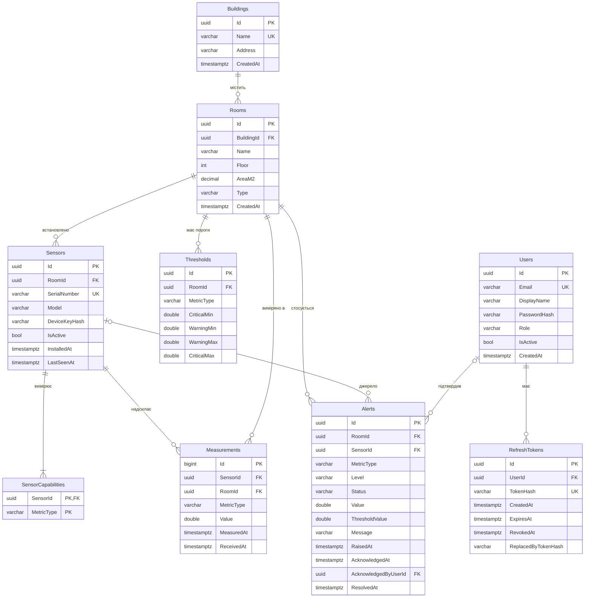

# Схема бази даних

Автор: Учасник 1. Статус: **чернетка на погодження** Учасниками 2 і 3 (PR Етапу 0).

Документ описує логічну модель даних системи моніторингу мікроклімату. Фізичне відображення через EF Core Fluent API (`Infrastructure/Persistence/Configurations`) буде на Етапі 1 і має повністю відповідати цьому документу.

## 1. Загальні правила

| Правило | Рішення | Чому |
|---|---|---|
| Первинні ключі | `uuid` (`Guid`) для всіх таблиць, крім `Measurements` | Id можна згенерувати до збереження (у домені й на клієнті); не розкриває кількість записів |
| Ключ `Measurements` | `bigint` identity (`long`) | Найбільша таблиця: 8 байт замість 16 у PK та в кожному індексі, послідовна вставка без фрагментації B-дерева |
| Час | `DateTimeOffset`, завжди UTC (`timestamptz` у PostgreSQL) | Немає плутанини з часовими поясами клієнтів і переходом на літній час |
| Enum-и | Зберігаються як **рядки** (`varchar(32)`) | Читабельність БД, стійкість до зміни порядку значень в enum. Мінус — більший обсяг; для `Measurements.MetricType` прийнятно |
| Рядки | Обмежена довжина (`varchar(n)`) | Захист від надмірних даних, прогнозований розмір індексів |
| Видалення | `RESTRICT` за замовчуванням; `CASCADE` лише для залежних даних без самостійної цінності | Історія вимірів і alert-ів не повинна зникати непомітно |
| Деактивація | `Sensors.IsActive`, `Users.IsActive` | Датчик чи користувач, що має історію, деактивується, а не видаляється |

Метрики (`MetricType`): `Temperature` (°C), `Humidity` (%), `Co2` (ppm), `Pm25` (µg/m³), `Noise` (dB), `Light` (lux).

## 2. ER-діаграма



## 3. Таблиці

### 3.1. `Buildings`

| Колонка | Тип | NULL | Обмеження | Коментар |
|---|---|---|---|---|
| `Id` | uuid | ні | PK | |
| `Name` | varchar(100) | ні | UNIQUE | Назва будівлі |
| `Address` | varchar(250) | так | | |
| `CreatedAt` | timestamptz | ні | | |

### 3.2. `Rooms`

| Колонка | Тип | NULL | Обмеження | Коментар |
|---|---|---|---|---|
| `Id` | uuid | ні | PK | |
| `BuildingId` | uuid | ні | FK → `Buildings.Id`, `ON DELETE RESTRICT` | |
| `Name` | varchar(100) | ні | UNIQUE (`BuildingId`, `Name`) | Номер/назва кімнати, унікальна в межах будівлі |
| `Floor` | int | ні | CHECK `Floor BETWEEN -5 AND 200` | |
| `AreaM2` | decimal(8,2) | так | CHECK `AreaM2 > 0` | |
| `Type` | varchar(32) | ні | значення `RoomType` | `Office`, `Classroom`, `Laboratory`, `Residential`, `ServerRoom`, `Other`; впливає на пороги за замовчуванням |
| `CreatedAt` | timestamptz | ні | | |

### 3.3. `Sensors`

| Колонка | Тип | NULL | Обмеження | Коментар |
|---|---|---|---|---|
| `Id` | uuid | ні | PK | |
| `RoomId` | uuid | ні | FK → `Rooms.Id`, `RESTRICT`; індекс | Поточна кімната датчика |
| `SerialNumber` | varchar(64) | ні | UNIQUE | |
| `Model` | varchar(100) | так | | |
| `DeviceKeyHash` | varchar(256) | ні | | Хеш ключа `X-Device-Key`; сам ключ не зберігається (див. `docs/security.md` Учасника 2) |
| `IsActive` | bool | ні | | Неактивний датчик не приймає виміри |
| `InstalledAt` | timestamptz | ні | | |
| `LastSeenAt` | timestamptz | так | | Час останнього прийнятого пакета; для визначення «офлайн» |

### 3.4. `SensorCapabilities`

| Колонка | Тип | NULL | Обмеження | Коментар |
|---|---|---|---|---|
| `SensorId` | uuid | ні | PK (`SensorId`, `MetricType`); FK → `Sensors.Id`, `ON DELETE CASCADE` | |
| `MetricType` | varchar(32) | ні | | Метрика, яку вміє вимірювати датчик |

Окрема таблиця замість поля-списку (`"Temperature,Humidity"`) — вимога 1НФ (атомарні значення) і можливість перевірити на рівні БД, що метрика належить датчику.

### 3.5. `Measurements`

| Колонка | Тип | NULL | Обмеження | Коментар |
|---|---|---|---|---|
| `Id` | bigint identity | ні | PK | |
| `SensorId` | uuid | ні | FK → `Sensors.Id`, `RESTRICT` | |
| `RoomId` | uuid | ні | FK → `Rooms.Id`, `RESTRICT` | Кімната, **де зроблено вимір** (див. 5.2) |
| `MetricType` | varchar(32) | ні | | |
| `Value` | double precision | ні | Фізичні межі перевіряє домен (`MetricLimits`) | |
| `MeasuredAt` | timestamptz | ні | | Час на датчику |
| `ReceivedAt` | timestamptz | ні | | Час прийому сервером; різниця з `MeasuredAt` показує затримки та розсинхрон годинника |

Обмеження та індекси:
- UNIQUE (`SensorId`, `MetricType`, `MeasuredAt`) — **ідемпотентність**: повторно надісланий пакет (після обриву з'єднання) не створює дублікатів.
- INDEX `IX_Measurements_Room_Metric_Time` (`RoomId`, `MetricType`, `MeasuredAt`) — основний запит аналітики `WHERE RoomId = @r AND MetricType = @m AND MeasuredAt BETWEEN @from AND @to`. Порядок колонок: спочатку рівність (`RoomId`, `MetricType`), потім діапазон (`MeasuredAt`) — так індекс використовується повністю і рядки вже відсортовані за часом.

### 3.6. `Thresholds`

| Колонка | Тип | NULL | Обмеження | Коментар |
|---|---|---|---|---|
| `Id` | uuid | ні | PK | |
| `RoomId` | uuid | ні | FK → `Rooms.Id`, `ON DELETE CASCADE` | |
| `MetricType` | varchar(32) | ні | UNIQUE (`RoomId`, `MetricType`) | Один набір порогів на метрику кімнати |
| `CriticalMin` | double | так | | |
| `WarningMin` | double | так | | |
| `WarningMax` | double | так | | |
| `CriticalMax` | double | так | | |

CHECK: для заданих (не NULL) значень `CriticalMin <= WarningMin < WarningMax <= CriticalMax`; хоча б одне значення задане. Ту саму перевірку виконує доменна сутність `Threshold`, тому CHECK у БД — другий рубіж захисту. Якщо для кімнати порогу немає, діють значення за замовчуванням (`DefaultThresholds`, див. `docs/analytics.md`).

### 3.7. `Alerts`

| Колонка | Тип | NULL | Обмеження | Коментар |
|---|---|---|---|---|
| `Id` | uuid | ні | PK | |
| `RoomId` | uuid | ні | FK → `Rooms.Id`, `RESTRICT` | |
| `SensorId` | uuid | так | FK → `Sensors.Id`, `SET NULL` | Датчик, значення якого спричинило alert |
| `MetricType` | varchar(32) | ні | | |
| `Level` | varchar(16) | ні | `Warning` / `Critical` | |
| `Status` | varchar(16) | ні | `Open` / `Acknowledged` / `Resolved` | |
| `Value` | double | ні | | Значення, що перевищило поріг |
| `ThresholdValue` | double | ні | | Межа, яку перевищено (знімок на момент події) |
| `Message` | varchar(500) | ні | | |
| `RaisedAt` | timestamptz | ні | | |
| `AcknowledgedAt` | timestamptz | так | | |
| `AcknowledgedByUserId` | uuid | так | FK → `Users.Id`, `SET NULL` | |
| `ResolvedAt` | timestamptz | так | | |

Індекси:
- `IX_Alerts_Status_RaisedAt` (`Status`, `RaisedAt` DESC) — стрічка відкритих сповіщень (екран Alerts).
- `IX_Alerts_Room_RaisedAt` (`RoomId`, `RaisedAt` DESC) — сповіщення конкретної кімнати.
- Частковий унікальний індекс (PostgreSQL) `UX_Alerts_Open` (`RoomId`, `MetricType`, `Level`) `WHERE Status = 'Open'` — не більше одного відкритого alert-а одного рівня на метрику кімнати (захист від спаму, див. `docs/analytics.md`). У SQLite часткові індекси теж підтримуються.

`ThresholdValue` — не дублювання `Thresholds`: пороги можуть змінитися пізніше, а alert зберігає історичний факт «яку межу перевищено тоді».

### 3.8. `Users`

| Колонка | Тип | NULL | Обмеження | Коментар |
|---|---|---|---|---|
| `Id` | uuid | ні | PK | |
| `Email` | varchar(256) | ні | UNIQUE | Зберігається в нижньому регістрі (нормалізує домен), тому унікальність не залежить від регістру в обох СУБД |
| `DisplayName` | varchar(100) | ні | | |
| `PasswordHash` | varchar(256) | ні | | PBKDF2 через `PasswordHasher<T>` (рішення Учасника 2) |
| `Role` | varchar(16) | ні | `Admin` / `Operator` / `Viewer` | |
| `IsActive` | bool | ні | | |
| `CreatedAt` | timestamptz | ні | | |

### 3.9. `RefreshTokens`

| Колонка | Тип | NULL | Обмеження | Коментар |
|---|---|---|---|---|
| `Id` | uuid | ні | PK | |
| `UserId` | uuid | ні | FK → `Users.Id`, `ON DELETE CASCADE`; індекс | |
| `TokenHash` | varchar(128) | ні | UNIQUE | Хеш токена (SHA-256, hex); сам токен не зберігається |
| `CreatedAt` | timestamptz | ні | | |
| `ExpiresAt` | timestamptz | ні | CHECK `ExpiresAt > CreatedAt` | |
| `RevokedAt` | timestamptz | так | | |
| `ReplacedByTokenHash` | varchar(128) | так | | Ланцюжок ротації: дозволяє виявити повторне використання старого токена |

Поля узгоджуються з моделлю безпеки Учасника 2 (`docs/security.md`); у разі розбіжностей пріоритет має погоджена версія PR.

## 4. Транзакції (критерій C5)

| Операція | Що має бути атомарним | Рівень |
|---|---|---|
| Інгест пакета вимірів | Вставка всіх вимірів пакета + оновлення `Sensors.LastSeenAt` + створення/закриття alert-ів | Одна транзакція; якщо частина пакета невалідна — пакет відхиляється повністю (`400`) |
| Імпорт CSV | Усі рядки файлу або жоден | Одна транзакція; при помилці — звіт про рядки з помилками, нічого не збережено |
| Ротація refresh-токена | Відкликати старий + створити новий | Одна транзакція; інакше можливі два активні токени |
| Підтвердження alert-а | Перевірка статусу + зміна | Оптимістична конкурентність (токен версії рядка) замість блокувань |
| Видалення кімнати | Перевірка відсутності датчиків/вимірів + видалення порогів | Одна транзакція; за наявності історії — заборона (`409`) |

Усі запити виконуються через EF Core, тобто **параметризовано** (захист від SQL-ін'єкцій). Сирі SQL-запити, якщо з'являться, — лише через `FromSql` з інтерполяцією параметрів.

## 5. Нормалізація

### 5.1. Перевірка нормальних форм

- **1НФ:** усі значення атомарні; списки метрик датчика винесено в `SensorCapabilities`; немає повторюваних груп колонок.
- **2НФ:** складений ключ має лише `SensorCapabilities` (`SensorId`, `MetricType`), і неключових атрибутів там немає. Решта таблиць має простий PK, тож часткових залежностей бути не може.
- **3НФ:** немає транзитивних залежностей неключових атрибутів від ключа. Назва будівлі зберігається лише в `Buildings` (у `Rooms` — тільки `BuildingId`), роль — лише в `Users`, межі порогів — лише в `Thresholds`.

### 5.2. Атрибути, схожі на дублювання, і чому це не порушення

| Атрибут | Чому не порушує 3НФ |
|---|---|
| `Measurements.RoomId` | Здається похідним від `Sensors.RoomId`, але це не так: датчик можуть перенести в іншу кімнату, а вимір має залишитися прив'язаним до кімнати, **де його зроблено**. Тобто `RoomId` залежить від самого виміру (історичний факт), а не транзитивно через поточний `SensorId → RoomId`. Додатковий виграш: аналітичні запити за кімнатою працюють по одному індексу без JOIN із `Sensors` |
| `Alerts.ThresholdValue` | Знімок межі на момент події; поточне значення в `Thresholds` може змінитися |
| `Alerts.MetricType`, `Alerts.RoomId` | Alert може бути створено без датчика (`SensorId` NULL, наприклад, за агрегатом), тому ці атрибути не виводяться з інших колонок |

## 6. Обсяг даних і зростання

Оцінка: 20 кімнат × 4 метрики × 1 вимір/хв = 80 рядків/хв ≈ **42 млн рядків на рік**. При ~60 байтах на рядок разом з індексами ≈ 5–6 ГБ/рік у PostgreSQL.

Стратегія (реалізація на Етапі 3 — за потреби):
1. Агрегування для аналітики виконується в БД (`GROUP BY` за інтервалом), а не в пам'яті.
2. Таблиця погодинних агрегатів `MeasurementHourly` (RoomId, MetricType, HourStart, Min, Max, Avg, Count), яку оновлює фонова задача.
3. Ретенція сирих даних (наприклад, 90 днів), довше зберігаються лише агрегати.
4. Для PostgreSQL — можливе секціонування `Measurements` за місяцями.

## 7. Провайдери БД (SQLite ↔ PostgreSQL)

| | SQLite | PostgreSQL |
|---|---|---|
| Для чого | Розробка, unit/integration-тести, швидкий запуск без Docker | Основна СУБД у Docker Compose, навантажувальні тести |
| Пакет EF Core | `Microsoft.EntityFrameworkCore.Sqlite` | `Npgsql.EntityFrameworkCore.PostgreSQL` |

Вибір провайдера — у конфігурації:

```json
{
  "Database": {
    "Provider": "Sqlite",
    "ConnectionString": "Data Source=microclimate.db"
  }
}
```

У Docker — змінні середовища `Database__Provider=Postgres`, `Database__ConnectionString=Host=db;...`.

**Окремі набори міграцій** для кожного провайдера (`Infrastructure/Persistence/Migrations/Sqlite`, `.../Postgres`, генеруються з параметром `--output-dir` і відповідним провайдером). Один набір не підходить: міграції містять провайдер-специфічні типи (`timestamptz` проти `TEXT`), анотації identity-колонок і DDL.

Відомі відмінності та рішення:

| Відмінність | Рішення |
|---|---|
| SQLite не має нативного типу для `DateTimeOffset` і не вміє коректно сортувати/порівнювати його в запитах | Для SQLite — `ValueConverter` `DateTimeOffset` → `long` (UTC ticks). Оскільки весь час в UTC, порядок зберігається |
| `decimal` у SQLite зберігається як `TEXT`, агрегати по ньому обмежені | `decimal` лише для `AreaM2` (без агрегатів); значення вимірів — `double` |
| Порівняння рядків без урахування регістру відрізняється | Email нормалізується до нижнього регістру в домені, тож порівняння завжди точне |
| CHECK-обмеження | Підтримуються обома; задаються через `ToTable(t => t.HasCheckConstraint(...))` |
| Часткові індекси | Підтримуються обома (`HasFilter`); текст фільтра може відрізнятися — задається умовно за провайдером |
| Оптимістична конкурентність | PostgreSQL — системна колонка `xmin`; SQLite — власна колонка `Version` з ручним інкрементом |

Перевірка: unit-тести репозиторіїв на SQLite (in-memory), інтеграційні — на PostgreSQL через Testcontainers (Етапи 1–2). Ті самі тести запускаються на обох провайдерах.
