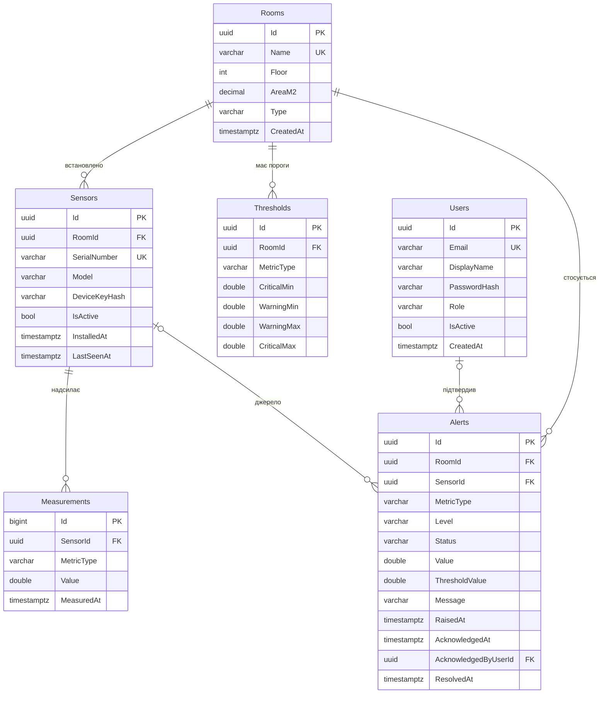

# Схема бази даних

Автор: Учасник 1. Статус: на погодженні з Учасниками 2 і 3.

Тут описано логічну модель даних. На Етапі 1 вона переноситься в EF Core через Fluent API (`Infrastructure/Persistence/Configurations`) і має повністю відповідати цьому документу.

## 1. Загальні правила

| Правило | Рішення | Чому |
|---|---|---|
| Первинні ключі | `uuid` (`Guid`), крім `Measurements` | Id створюється в коді ще до збереження в БД |
| Ключ `Measurements` | `bigint` identity (`long`) | Найбільша таблиця, тому ключ компактніший |
| Час | `DateTimeOffset`, завжди UTC | Без плутанини з часовими поясами |
| Enum-и | Зберігаються як рядки (`varchar(32)`) | Значення видно в БД без коду, зміна порядку в enum нічого не ламає |
| Видалення | `RESTRICT` за замовчуванням, `CASCADE` лише для порогів кімнати | Історія вимірів і сповіщень не має зникати разом з кімнатою чи датчиком |

Метрики (`MetricType`): `Temperature` (°C), `Humidity` (%), `Co2` (ppm), `Pm25` (µg/m³), `Noise` (dB), `Light` (lux).

## 2. ER-діаграма



## 3. Таблиці

### 3.1. `Rooms`

| Колонка | Тип | NULL | Обмеження |
|---|---|---|---|
| `Id` | uuid | ні | PK |
| `Name` | varchar(100) | ні | UNIQUE |
| `Floor` | int | ні | CHECK `Floor BETWEEN -5 AND 200` |
| `AreaM2` | decimal(8,2) | так | CHECK `AreaM2 > 0` |
| `Type` | varchar(32) | ні | `Office`, `Classroom`, `Laboratory`, `Residential`, `ServerRoom`, `Other` |
| `CreatedAt` | timestamptz | ні | |

`Type` впливає на пороги за замовчуванням (наприклад, у серверній інші межі температури).

### 3.2. `Sensors`

| Колонка | Тип | NULL | Обмеження |
|---|---|---|---|
| `Id` | uuid | ні | PK |
| `RoomId` | uuid | ні | FK → `Rooms.Id`, `RESTRICT`; індекс `IX_Sensors_RoomId` |
| `SerialNumber` | varchar(64) | ні | UNIQUE |
| `Model` | varchar(100) | так | |
| `DeviceKeyHash` | varchar(256) | ні | Хеш ключа `X-Device-Key`, сам ключ не зберігається; індекс `IX_Sensors_DeviceKeyHash` для пошуку датчика при кожному запиті з вимірами |
| `IsActive` | bool | ні | Неактивний датчик не приймає виміри |
| `InstalledAt` | timestamptz | ні | |
| `LastSeenAt` | timestamptz | так | Час останнього прийнятого виміру |

Один датчик може надсилати кілька метрик (наприклад, температуру, вологість і CO₂).

### 3.3. `Measurements`

| Колонка | Тип | NULL | Обмеження |
|---|---|---|---|
| `Id` | bigint identity | ні | PK |
| `SensorId` | uuid | ні | FK → `Sensors.Id`, `RESTRICT` |
| `MetricType` | varchar(32) | ні | |
| `Value` | double precision | ні | Фізичні межі перевіряє домен (`MetricLimits`) |
| `MeasuredAt` | timestamptz | ні | |

Індекс `IX_Measurements_Sensor_Metric_Time` (`SensorId`, `MetricType`, `MeasuredAt`) обслуговує основний запит «метрика кімнати за період»:

```sql
SELECT m.*
FROM Measurements m
JOIN Sensors s ON s.Id = m.SensorId
WHERE s.RoomId = @roomId AND m.MetricType = @metric AND m.MeasuredAt >= @from AND m.MeasuredAt < @to
```

У кімнаті кілька датчиків, тому БД знаходить їх через `IX_Sensors_RoomId`, а для кожного датчика бере потрібний діапазон з індексу вимірів. Порядок колонок в індексі такий: спочатку поля з умовою рівності (`SensorId`, `MetricType`), потім поле діапазону (`MeasuredAt`). Тоді індекс використовується повністю, а рядки вже впорядковані за часом.

### 3.4. `Thresholds`

| Колонка | Тип | NULL | Обмеження |
|---|---|---|---|
| `Id` | uuid | ні | PK |
| `RoomId` | uuid | ні | FK → `Rooms.Id`, `CASCADE` |
| `MetricType` | varchar(32) | ні | UNIQUE (`RoomId`, `MetricType`) |
| `CriticalMin`, `WarningMin`, `WarningMax`, `CriticalMax` | double | так | CHECK: `CriticalMin <= WarningMin < WarningMax <= CriticalMax` для заданих значень |

Якщо для кімнати порогу немає, діють значення за замовчуванням з `docs/analytics.md`. Те саме правило порядку меж перевіряє доменний клас `ThresholdLimits`, тож CHECK у БД — додатковий захист.

### 3.5. `Alerts`

| Колонка | Тип | NULL | Обмеження |
|---|---|---|---|
| `Id` | uuid | ні | PK |
| `RoomId` | uuid | ні | FK → `Rooms.Id`, `RESTRICT` |
| `SensorId` | uuid | так | FK → `Sensors.Id`, `SET NULL` |
| `MetricType` | varchar(32) | ні | |
| `Level` | varchar(16) | ні | `Warning` / `Critical` |
| `Status` | varchar(16) | ні | `Open` / `Acknowledged` / `Resolved` |
| `Value` | double | ні | Значення, що вийшло за поріг |
| `ThresholdValue` | double | ні | Межа, яку перевищено (на момент події) |
| `Message` | varchar(500) | ні | |
| `RaisedAt` | timestamptz | ні | |
| `AcknowledgedAt` | timestamptz | так | |
| `AcknowledgedByUserId` | uuid | так | FK → `Users.Id`, `SET NULL` |
| `ResolvedAt` | timestamptz | так | |

Індекси:
- `IX_Alerts_Status_RaisedAt` (`Status`, `RaisedAt`) — стрічка сповіщень на екрані Alerts;
- `IX_Alerts_Room_Metric_Status` (`RoomId`, `MetricType`, `Status`) — пошук незакритого сповіщення під час прийому вимірів.

### 3.6. `Users`

| Колонка | Тип | NULL | Обмеження |
|---|---|---|---|
| `Id` | uuid | ні | PK |
| `Email` | varchar(256) | ні | UNIQUE; зберігається в нижньому регістрі |
| `DisplayName` | varchar(100) | ні | |
| `PasswordHash` | varchar(256) | ні | Хеш пароля, формує шар Api |
| `Role` | varchar(16) | ні | `Admin` / `Operator` / `Viewer` |
| `IsActive` | bool | ні | |
| `CreatedAt` | timestamptz | ні | |

## 4. Транзакції

| Операція | Що має бути атомарним |
|---|---|
| Прийом пакета вимірів | Вставка всіх вимірів пакета, оновлення `Sensors.LastSeenAt`, створення та закриття сповіщень. Якщо хоч один вимір некоректний, пакет відхиляється повністю |
| Видалення кімнати | Перевірка, що в кімнаті немає датчиків, і видалення її порогів |

Усі запити йдуть через EF Core, тобто параметризовано, що захищає від SQL-ін'єкцій.

## 5. Нормалізація

- **1НФ:** усі значення атомарні, повторюваних груп колонок немає.
- **2НФ:** складених первинних ключів немає, тому часткових залежностей бути не може.
- **3НФ:** транзитивних залежностей немає. Кімнату виміру отримуємо через `Sensors.RoomId`, а не дублюємо в `Measurements`. Роль зберігається тільки в `Users`, межі порогів — тільки в `Thresholds`.

Два атрибути в `Alerts` можуть здатися дублюванням, але ним не є:
- `ThresholdValue` — значення межі на момент події; поріг у `Thresholds` пізніше можуть змінити, а сповіщення має показувати, що саме було перевищено тоді;
- `RoomId` — сповіщення стосується кімнати навіть тоді, коли датчик видалено (`SensorId` стає NULL).

## 6. Провайдери БД: SQLite і PostgreSQL

| | SQLite | PostgreSQL |
|---|---|---|
| Для чого | Розробка, тести, запуск без Docker | Основна БД у Docker Compose |
| Пакет EF Core | `Microsoft.EntityFrameworkCore.Sqlite` | `Npgsql.EntityFrameworkCore.PostgreSQL` |

Провайдер вибирається в конфігурації:

```json
{
  "Database": {
    "Provider": "Sqlite",
    "ConnectionString": "Data Source=microclimate.db"
  }
}
```

У Docker використовуються змінні середовища `Database__Provider=Postgres` і `Database__ConnectionString=Host=db;...`.

Міграції генеруються окремо для кожного провайдера, бо в них різні типи колонок і DDL. Для цього є два контексти-нащадки спільного `AppDbContext`: `SqliteAppDbContext` і `PostgresAppDbContext` (`src/Microclimate.Infrastructure/Persistence`). Міграції лежать у `Persistence/Migrations/Sqlite` і `Persistence/Migrations/Postgres`.

Команди (інструмент `dotnet-ef` встановлюється локально командою `dotnet tool restore`):

```bash
# нова міграція для обох провайдерів
dotnet ef migrations add <Назва> --project src/Microclimate.Infrastructure --startup-project src/Microclimate.Infrastructure --context SqliteAppDbContext --output-dir Persistence/Migrations/Sqlite
dotnet ef migrations add <Назва> --project src/Microclimate.Infrastructure --startup-project src/Microclimate.Infrastructure --context PostgresAppDbContext --output-dir Persistence/Migrations/Postgres

# створити або оновити локальну БД SQLite (файл microclimate.db)
dotnet ef database update --project src/Microclimate.Infrastructure --startup-project src/Microclimate.Infrastructure --context SqliteAppDbContext
```

Реєстрація в DI: `services.AddInfrastructure(configuration)` читає `Database:Provider` і `Database:ConnectionString`.

Відмінності провайдерів, які треба врахувати:

| Відмінність | Рішення |
|---|---|
| SQLite не вміє порівнювати й сортувати `DateTimeOffset` у запитах | Для SQLite — конвертер `DateTimeOffset` → `long` (UTC ticks); оскільки весь час в UTC, порядок зберігається |
| `decimal` у SQLite зберігається як текст | `decimal` лише для `AreaM2`, по якому немає агрегатів; значення вимірів — `double` |
| Порівняння рядків без урахування регістру відрізняється | Email приводиться до нижнього регістру в домені, тож порівняння завжди точне |
