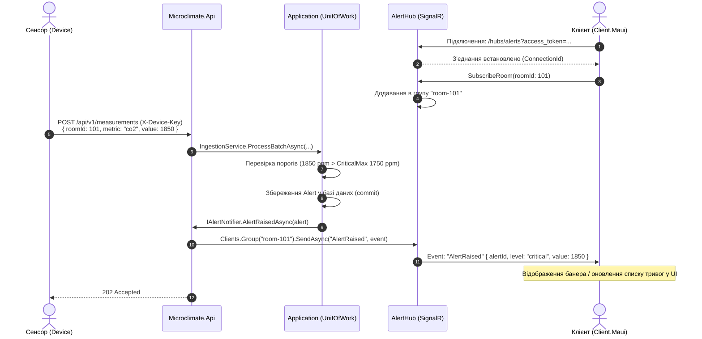

# Специфікація подій реального часу SignalR (docs/realtime.md)

Цей документ визначає контракт двосторонньої взаємодії в реальному часі між клієнтами (`Client.Maui`) та сервером `Microclimate.Api` через технологію ASP.NET Core SignalR.

> **Статус етапу:** На Етапі 0 зафіксовано публічний контракт подій, групи та протокол. Повна серверна та клієнтська реалізація хаба буде виконана на **Етапі 3**.

---

## 1. Точка підключення та автентифікація

- **Шлях до хаба:** `/hubs/alerts`
- **Протокол:** WebSockets (пріоритетний) з автоматичним переходом (fallback) на Server-Sent Events або Long Polling у разі мережевих обмежень.
- **Вимоги до автентифікації:** Обов'язкова валідна сесія користувача (`[Authorize]`).
- **Передача токена авторизації:**
  Токен передається через query-параметр URL:
  ```text
  GET /hubs/alerts?access_token=<jwt-access-token>
  ```
  **Чому через query `access_token`:**
  Стандартний браузерний та деякі клієнтські стеки WebSocket API не підтримують передачу довільних HTTP-заголовків (таких як `Authorization: Bearer ...`) під час первинного handshake-запиту. Тому в екосистемі ASP.NET Core SignalR стандартним рішенням є передача токена в параметрі `access_token`, який зчитується сервером в обробнику події `JwtBearerEvents.OnMessageReceived` при зверненні до шляху `/hubs/*`.

---

## 2. Модель підписок і групи SignalR

Для оптимізації мережевого навантаження клієнти отримують оновлення лише за тими кімнатами, які вони наразі переглядають у UI:

### 2.1. Автоматичні системні групи
- При успішному підключенні користувачі з ролями **`Admin`** та **`Operator`** автоматично додаються до системної групи:
  - **`all-alerts`**: отримує сповіщення про перевищення порогів у **всіх** приміщеннях об'єкта.

### 2.2. Динамічні групи приміщень
Клієнтський додаток (наприклад, при відкритті екрана `RoomDetails`) викликає методи хаба для підписки на кімнату:
- **`SubscribeRoom(Guid roomId)`**: додає з'єднання клієнта (`Context.ConnectionId`) до групи `room-{roomId}`.
- **`UnsubscribeRoom(Guid roomId)`**: видаляє з'єднання клієнта з групи `room-{roomId}`.

Формат назви групи: `$"room-{roomId:D}"` (наприклад, `room-3fa85f64-5717-4562-b3fc-2c963f66afa6`).

---

## 3. Методи та події сервера клієнту (Server → Client)

Усі назви методів зафіксовані як рядкові константи у спільному контракті `Microclimate.Contracts.Realtime.HubMethods`:

```csharp
namespace Microclimate.Contracts.Realtime;

public static class HubMethods
{
    public const string AlertRaised = "AlertRaised";
    public const string AlertAcknowledged = "AlertAcknowledged";
    public const string MeasurementReceived = "MeasurementReceived";
}
```

### 3.1. Подія `AlertRaised`
Надсилається, коли значення метрики перевищує поріг кімнати (`Warning` або `Critical`) і в базі зафіксовано нову тривогу.
- **Отримувачі:** Група `room-{roomId}` та група `all-alerts`.
- **Payload (`AlertRaisedEvent`):**
```json
{
  "alertId": "7e2a9128-4421-4f1e-9279-8b83e71d34e2",
  "roomId": "3fa85f64-5717-4562-b3fc-2c963f66afa6",
  "roomName": "Серверна 101",
  "metric": "temperature",
  "level": "critical",
  "value": 34.2,
  "threshold": 32.0,
  "message": "Температура 34.2°C перевищує критичну межу 32.0°C",
  "createdAt": "2026-10-12T14:32:00Z"
}
```

### 3.2. Подія `AlertAcknowledged`
Надсилається, коли оператор або адміністратор квитує (підтверджує ознайомлення) активну тривогу через `POST /api/v1/alerts/{id}/acknowledge`.
- **Отримувачі:** Група `room-{roomId}` та група `all-alerts`.
- **Payload:**
```json
{
  "alertId": "7e2a9128-4421-4f1e-9279-8b83e71d34e2",
  "acknowledgedBy": "operator@microclimate.local",
  "acknowledgedAt": "2026-10-12T14:35:10Z"
}
```

### 3.3. Подія `MeasurementReceived`
Надсилається для оновлення поточних показників кімнати в реальному часі на дашборді або сторінці деталей.
- **Отримувачі:** Група `room-{roomId}`.
- **Обмеження частоти (Rate Throttling):** Не частіше ніж 1 раз на 5 секунд для однієї кімнати, щоб не перевантажувати клієнт рендерингом при частому надсиланні пакетів.
- **Payload (`MeasurementReceivedEvent`):**
```json
{
  "roomId": "3fa85f64-5717-4562-b3fc-2c963f66afa6",
  "metric": "co2",
  "value": 850.0,
  "measuredAt": "2026-10-12T14:32:05Z"
}
```

---

## 4. Стратегія клієнтського перепідключення (Reconnection)

Клієнтський застосунок (.NET MAUI, Учасник 3) конфігурує хаб з автоматичним відновленням з'єднання:
```csharp
var hubConnection = new HubConnectionBuilder()
    .WithUrl("https://api.microclimate.local/hubs/alerts", options =>
    {
        options.AccessTokenProvider = () => Task.FromResult(authService.GetAccessToken());
    })
    .WithAutomaticReconnect(new[] {
        TimeSpan.Zero,
        TimeSpan.FromSeconds(2),
        TimeSpan.FromSeconds(5),
        TimeSpan.FromSeconds(10)
    })
    .Build();

hubConnection.Reconnected += async connectionId =>
{
    // Обов'язково: повторна підписка на активні відкриті кімнати після поновлення сесії
    if (currentRoomId.HasValue)
    {
        await hubConnection.InvokeAsync("SubscribeRoom", currentRoomId.Value);
    }
};
```

---

## 5. Діаграма послідовності обробки подій у реальному часі


