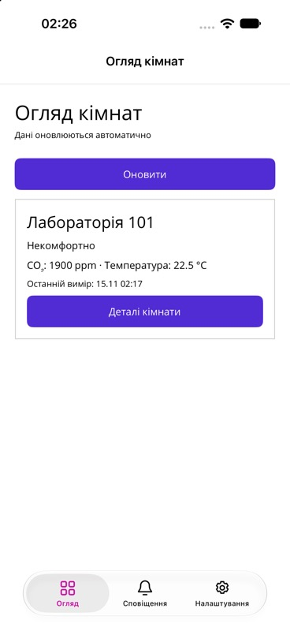
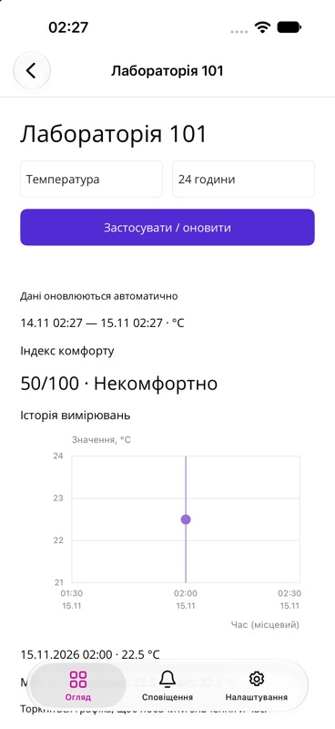
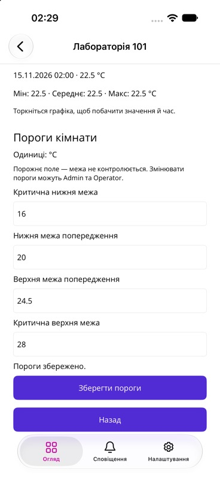
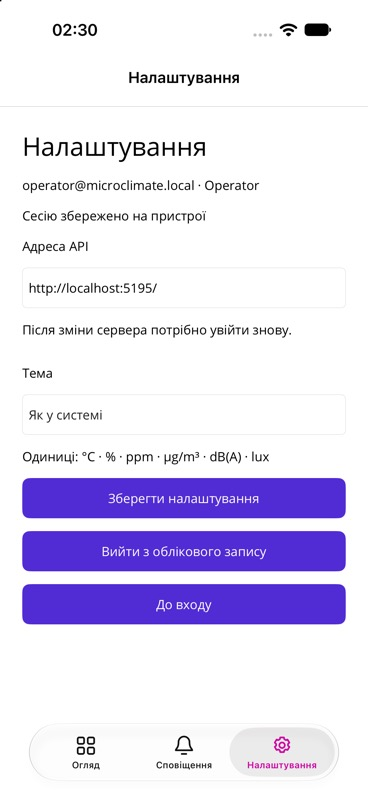
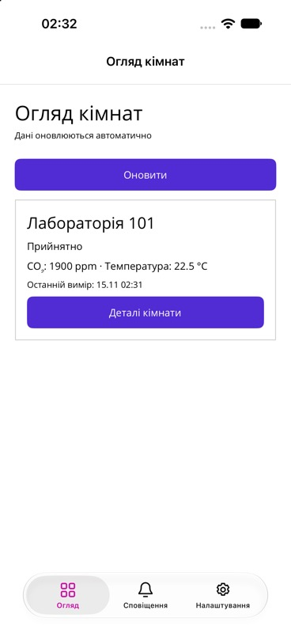

# Нативний iOS-прогін — 15.11.2026

Середовище: iPhone 18 Pro Simulator, iOS 27.2, Xcode 27.2, .NET SDK/workload set 10.0.404, MAUI 10.0.110. API — Development із чистого клону commit f5e0e9e, ізольована SQLite, `http://localhost:5195/`. Клієнтський код — commit 26d3fa1; подальші зміни цього прогону стосуються CI, smoke та документації. Перевірку виконав Codex через нативний UI; це не людське рев'ю.

## Збірка й підпис

```bash
dotnet workload install maui-ios --version 10.0.404
dotnet build src/Microclimate.Client.Maui -t:Rebuild -c Debug -f net10.0-ios \
  -p:MauiTargetFramework=net10.0-ios -p:RuntimeIdentifier=iossimulator-arm64 \
  -p:EnableCodeSigning=true -p:CodesignKey=-
```

Повна збірка: **0 warnings, 0 errors**. Bundle ID: `com.companyname.microclimate.client.maui`; app: `src/Microclimate.Client.Maui/bin/Debug/net10.0-ios/iossimulator-arm64/Microclimate.Client.Maui.app`.

Перший запуск із вимкненим підписом завершився системним `CodeSignatureInvalid / InvalidPage` до старту застосунку. Після rebuild з ad-hoc підписом застосунок запустився й пройшов наведені сценарії. Вимикати signing для цього Simulator не слід.

## Спостережені сценарії

| Дія | Фактичний результат |
|---|---|
| Неповний пароль → правильний demo Operator | Валідація мінімальної довжини; після виправлення відкрився огляд |
| Огляд | Лабораторія 101, CO₂ 1900 ppm, температура 22.5 °C, час останнього виміру й комфорт із сервера |
| Деталі й дотик графіка | Метрика/період, комфорт, min/avg/max; вибрана точка 15.11.2026 02:00, 22.5 °C |
| Зміна температурного warningMax 25 → 24.5 | Після Save показано «Пороги збережено» |
| Вкладка сповіщень | Видима критична CO₂-тривога, вже підтверджена HTTP smoke; ручний acknowledge на iOS не перевірявся |
| Налаштування | Профіль Operator, правильна адреса, «Сесію збережено на пристрої» |
| Завершення процесу й повторний запуск | Огляд відкрився без повторного введення пароля: сесія відновилася |
| Нові виміри через smoke, без натискання Refresh | Час на картці оновився з 02:17 до 02:31, змінився серверний комфорт |
| Logout | Повернення на Login із порожніми полями |







## Логи та межі доказу

У логах успішних запусків не виявлено managed unhandled exception. Є повідомлення про недоступний IDE debug socket, UIApplication background-fetch mode та дубльований UIKit accessibility-клас у системному Simulator. Вони не завадили сценаріям; це не твердження про повну відсутність усіх native warnings. [SARIF-підсумок iOS](../evidence/2026-11-15/ios-static-analysis.md): 0 активних error/warning, інформаційні й suppressed diagnostics збережені.

SecureStorage із перезапуском підтверджено **в цьому Simulator**. Фізичний iPhone, release-підпис, перевстановлення, Windows/Android UI й усі поєднання тем/метрик тут не перевірялись. Mac-сценарії наведено [окремо](mac-smoke-2026-11-15.md). Чи зараховується Simulator для C0, визначає викладач; сам показ на захисті ще попереду.
