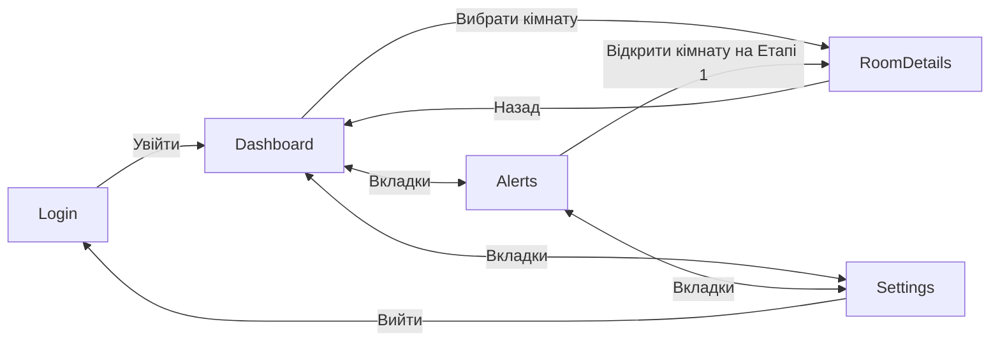

# Вайрфрейми клієнта

Вайрфрейми — чернетка, узгодити з Учасниками 1 і 2 (дані та ендпоінти). Це цільовий дизайн наступних етапів; Етап 0 реалізує тільки заголовки, заглушки та переходи. Ролі нижче — пропозиція, а не реалізований контроль доступу.

## Login

**Мета:** увійти до системи та отримати доступ відповідно до ролі.

**Елементи:** email, пароль із прихованим вводом, «Увійти», індикатор завантаження, повідомлення про помилку.

**Дії:** ввести дані → натиснути «Увійти» → Dashboard у разі успіху; помилка залишає на Login. На Етапі 0 кнопка лише переходить без перевірки.

**Ролі:** Admin / Operator / Viewer до автентифікації.

```text
┌──────────────────────────────────┐
│            Мікроклімат           │
│                                  │
│ Email     [____________________] │
│ Пароль    [••••••••____________] │
│                                  │
│            [ Увійти ]            │
│ Помилка: перевірте дані входу     │
└──────────────────────────────────┘
```

## Dashboard

**Мета:** швидко оцінити стан кімнат і вибрати приміщення для аналізу.

**Елементи:** картки кімнат із T, RH, CO₂, статусом (норма / попередження / критично), час останнього вимірювання, порожній стан і pull-to-refresh.

**Дії:** натиснути кімнату → RoomDetails; потягнути вниз → оновити; вкладки → Alerts або Settings.

**Ролі:** Admin / Operator / Viewer.

```text
┌──────────────────────────────────┐
│ Огляд кімнат                     │
├──────────────────────────────────┤
│ 101  22.4°C  RH 45%  CO₂ 650 ppm │
│ ● Норма       Оновлено 10:42      │
│ 102  26.1°C  RH 38%  CO₂ 1200 ppm│
│ ▲ Попередження                   │
│ 201  29.0°C  RH 70%  CO₂ 1800 ppm│
│ ! Критично                       │
├──────────────────────────────────┤
│ [Огляд] [Сповіщення] [Налаштув.]  │
└──────────────────────────────────┘
```

Колір дублюється текстом і символом; значення в макеті демонстраційні й не визначають погоджених порогів.

## RoomDetails

**Мета:** дослідити показники кімнати за період і зрозуміти її комфортність.

**Елементи:** назва кімнати, вибір метрики (T / RH / CO₂ / PM2.5 / шум / освітленість), період 24 год / 7 днів / 30 днів, графік, min/max/avg, індекс комфорту, пороги.

**Дії:** змінити метрику/період → перерахунок графіка; назад → Dashboard; редагування порогів для Admin / Operator після підключення API.

**Ролі:** перегляд — Admin / Operator / Viewer; зміна порогів — Admin / Operator.

```text
┌──────────────────────────────────┐
│ [←] Кімната 101                   │
│ Метрика [Температура ▾]           │
│ [24 год] [7 днів] [30 днів]       │
├──────────────────────────────────┤
│ °C       ╭──╮  ╭────╮            │
│ 24 ──────╯  ╰──╯    ╰────        │
│ 20 ──────────────────────        │
│    00:00      12:00     24:00     │
├──────────────────────────────────┤
│ Min 21.0  Max 24.0  Avg 22.4°C    │
│ Комфорт: 85/100 · Комфортно       │
│ Пороги: [перегляд] [редагувати*]  │
└──────────────────────────────────┘
```

Графік використовує часовий ряд Учасника 1: Count = 0 або Avg = null розривають лінію. Відсутні виміри не перетворюються на нуль. Для ComfortCategory.NoData показуємо «Немає даних»; справжній Index = 0 відображається як оцінка 0/100. Категорію повертає сервер, клієнт не перераховує її пороги. Демонстраційні числа в макеті не є результатом аналізу.

## Alerts

**Мета:** побачити перевищення порогів і опрацювати повідомлення.

**Елементи:** фільтр рівня, стрічка з рівнем, кімнатою, метрикою, значенням і часом; стан Open / Acknowledged / Resolved; порожній стан.

**Дії:** обрати рівень → фільтрація; натиснути запис → RoomDetails; «Підтвердити» → Open → Acknowledged через API.

**Ролі:** перегляд — Admin / Operator / Viewer; підтвердження — Admin / Operator; Viewer лише переглядає.

```text
┌──────────────────────────────────┐
│ Сповіщення        Рівень [Усі ▾] │
├──────────────────────────────────┤
│ ! Критично · кімната 201          │
│ CO₂ 1800 ppm · 10:42              │
│ [Відкрити] [Підтвердити] │
│                                  │
│ ▲ Попередження · кімната 102      │
│ Температура 26.1°C · 10:38        │
│ ✓ Підтверджено                      │
├──────────────────────────────────┤
│ [Огляд] [Сповіщення] [Налаштув.]  │
└──────────────────────────────────┘
```

## Settings

**Мета:** налаштувати локальну поведінку клієнта й завершити сесію.

**Елементи:** адреса API, тема світла/темна, одиниці показників, збереження, вихід.

**Дії:** змінити параметри → зберегти локально після валідації; «Вийти» → очищення сесії й Login. На Етапі 0 вихід лише змінює маршрут.

**Ролі:** Admin / Operator / Viewer; параметри стосуються локального клієнта.

```text
┌──────────────────────────────────┐
│ Налаштування                     │
├──────────────────────────────────┤
│ Адреса API                       │
│ [https://api.example.test______] │
│ Тема       [Світла ▾]            │
│ Температура [°C ▾]               │
│ Інші одиниці [SI ▾]              │
│                                  │
│ [Зберегти]                       │
│ [Вийти]                          │
├──────────────────────────────────┤
│ [Огляд] [Сповіщення] [Налаштув.]  │
└──────────────────────────────────┘
```

## Навігація



Оновлено відповідно до D-1-001 та docs/analytics.md: модель без будівель, одиниця шуму dB(A), комфорт від 85, підтвердження сповіщень через acknowledge. Клієнтські проєкції не використовують legacy BuildingId/BuildingName у Contracts; їх оновлення належить Учаснику 2. Мокапи не є скриншотами працюючого застосунку.
